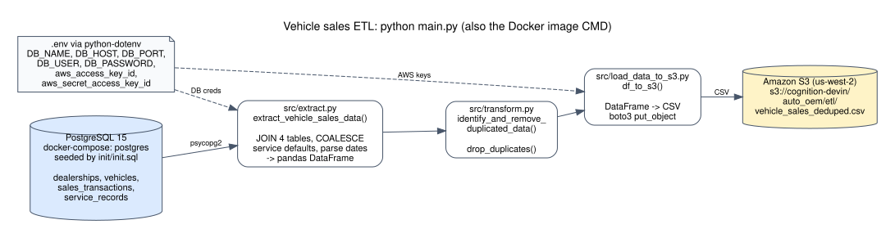
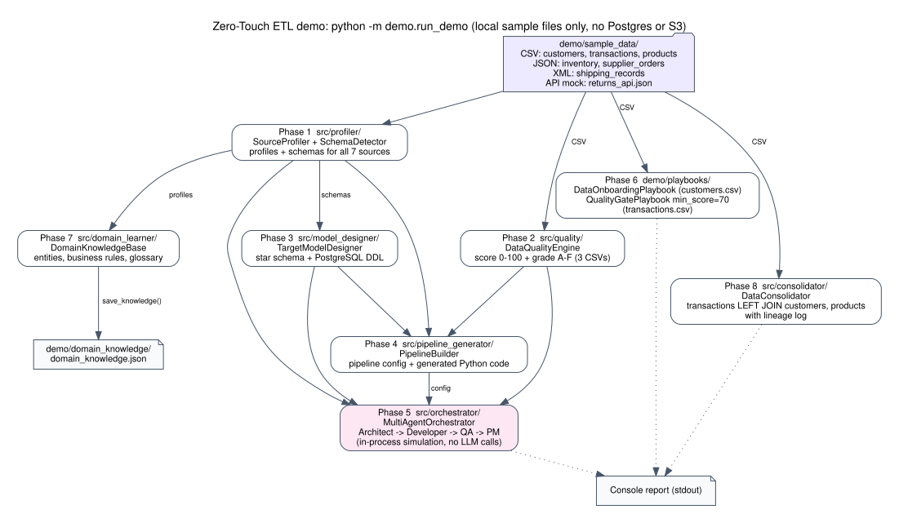
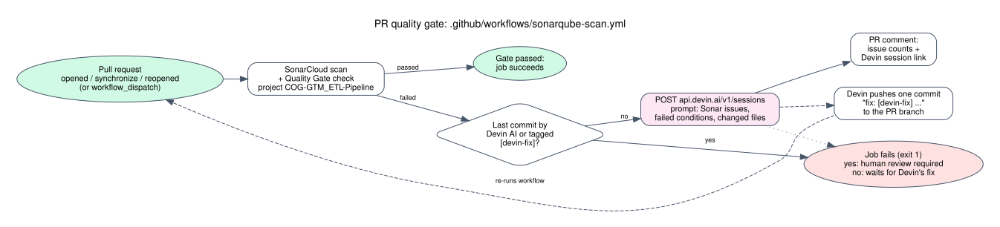

# Architecture

`main` contains three independent paths. They share no code at runtime: `main.py` only imports `src/extract.py`, `src/transform.py` and `src/load_data_to_s3.py`, while the demo runner only uses the `src/*/` subpackages and `demo/`.

| Path | Entry point | Inputs | Outputs |
|------|-------------|--------|---------|
| [Vehicle sales ETL](#1-vehicle-sales-etl) | `python main.py` (also the `Dockerfile` CMD) | PostgreSQL (`docker-compose.yml`, seeded by `init/init.sql`) | CSV in Amazon S3 |
| [Zero-Touch ETL demo](#2-zero-touch-etl-demo) | `python -m demo.run_demo` | Files in `demo/sample_data/` | Console report, `demo/domain_knowledge/domain_knowledge.json` |
| [PR quality gate](#3-pr-quality-gate) | `.github/workflows/sonarqube-scan.yml` | Pull request events | SonarCloud result, Devin remediation session, PR comment |

The diagrams are Graphviz sources in [`docs/diagrams/`](diagrams/). After editing a `.dot` file, regenerate its SVG:

```bash
dot -Tsvg docs/diagrams/<name>.dot -o docs/diagrams/<name>.svg
```

## 1. Vehicle sales ETL



1. `main.py` reads database and AWS credentials from the environment (`.env` via `python-dotenv`).
2. `extract_vehicle_sales_data()` connects to PostgreSQL with `psycopg2` and runs one query that joins `vehicles`, `dealerships`, `sales_transactions` and `service_records`, defaulting missing service rows to `service_type = 'Unknown'` and `service_cost = 0`. Dates are parsed into a pandas DataFrame.
3. `identify_and_remove_duplicated_data()` drops duplicate rows.
4. `df_to_s3()` writes the DataFrame as CSV to `s3://cognition-devin/auto_oem/etl/vehicle_sales_deduped.csv` (region `us-west-2`).

Things to know:

- The source is PostgreSQL. Locally, `docker-compose up -d postgres` starts Postgres 15 (`etl_db`, user `postgres`) and runs `init/init.sql` to create and seed the four tables.
- `main.py` reads `DB_NAME`, `DB_HOST`, `DB_PORT`, `DB_USER`, `DB_PASSWORD`, `aws_access_key_id` and `aws_secret_access_key_id`. `.env.example` lists the database keys in lowercase (`dbname`, `host`, ...), which `main.py` does not read.
- `df_to_s3()` catches `botocore` `ClientError` and only prints it, so `main.py` still prints "Data successfully uploaded to S3" when the upload fails.

## 2. Zero-Touch ETL demo



`demo/run_demo.py` runs eight phases in one process against the sample files (set `DEMO_AUTO_RUN=1` to skip the pauses). It does not touch PostgreSQL or S3. See [`demo/README.md`](../demo/README.md) for what each phase shows.

| Phase | Module | Reads | Produces |
|-------|--------|-------|----------|
| 1 | `src/profiler/` `SourceProfiler`, `SchemaDetector` | All 7 sample sources (CSV, JSON, XML, API mock) | Profiles, detected schemas, DDL |
| 2 | `src/quality/` `DataQualityEngine` | The 3 CSVs | Quality score (0-100) and grade (A-F) per source |
| 3 | `src/model_designer/` `TargetModelDesigner` | Schemas from phase 1 | Star schema with `transactions` as the fact table, PostgreSQL DDL |
| 4 | `src/pipeline_generator/` `PipelineBuilder` | Phases 1-3 | Pipeline config and generated Python code (printed, not run) |
| 5 | `src/orchestrator/` `MultiAgentOrchestrator` | Phases 1-4 | Architect, Developer, QA and PM persona reports and a workflow log |
| 6 | `demo/playbooks/` `DataOnboardingPlaybook`, `QualityGatePlaybook` | `customers.csv`, `transactions.csv` | Onboarding report, go/no-go against `min_score=70` |
| 7 | `src/domain_learner/` `DomainKnowledgeBase` | Profiles from phase 1 | `demo/domain_knowledge/domain_knowledge.json` |
| 8 | `src/consolidator/` `DataConsolidator` | The 3 CSVs | `transactions` left-joined to `customers` and `products`, with lineage |

Things to know:

- `MultiAgentOrchestrator` is a deterministic, in-process simulation: each persona records actions computed from the earlier phases' outputs. It makes no LLM or network calls.
- `demo/playbooks/cross_system_merge.py` (`CrossSystemMergePlaybook`) exists but `run_demo.py` does not run it.
- `demo/zero_touch_etl.html` is a static presentation page about the demo; nothing generates or reads it.

## 3. PR quality gate



On every pull request (or a manual `workflow_dispatch` with a PR number and branch), the workflow runs a SonarCloud scan and checks the Quality Gate. If the gate fails and the PR's last commit is neither authored by `Devin AI` nor tagged `[devin-fix]`, it collects the SonarCloud issues and the PR's changed files, starts a Devin session through `POST https://api.devin.ai/v1/sessions`, and comments on the PR with the session link. Devin is asked to push a single `fix: [devin-fix] ...` commit to the PR branch, which re-runs the workflow. The `[devin-fix]` check stops a second remediation loop: if the gate still fails after Devin's commit, the job fails for human review. The job also fails (exit 1) on the run that triggers Devin.
