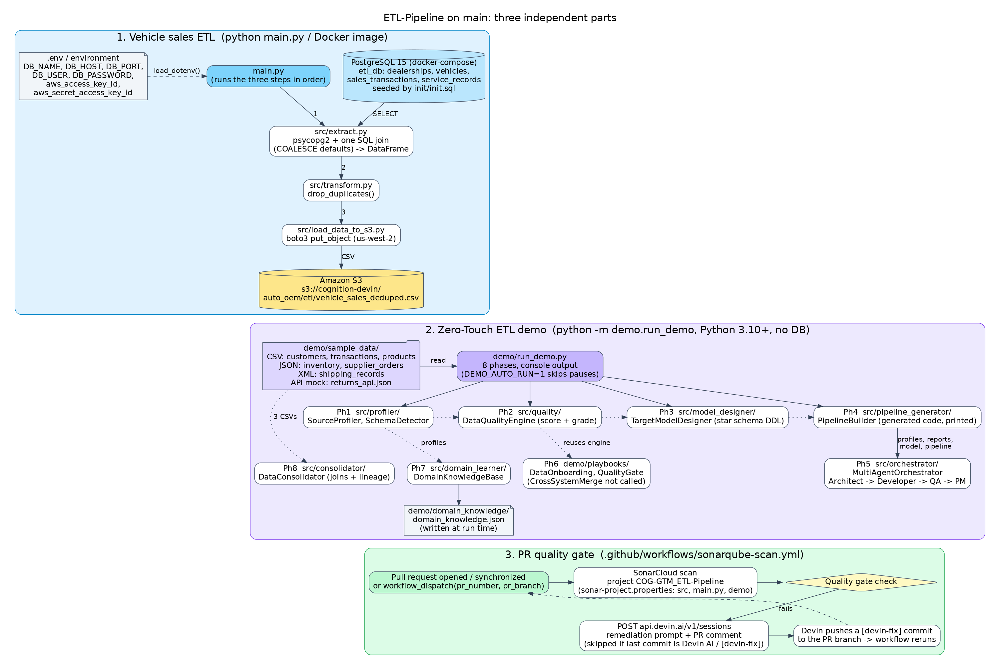

# Architecture

This page describes what the code on `main` does today. The repository holds three parts that share a Git history but no runtime code:

1. **Vehicle sales ETL** (`main.py`, `src/extract.py`, `src/transform.py`, `src/load_data_to_s3.py`): reads vehicle sales and service records from PostgreSQL, removes duplicate rows and writes one CSV to Amazon S3.
2. **Zero-Touch ETL demo** (`demo/`, `src/<subpackage>/`): a console walkthrough that profiles bundled sample files, scores their quality, designs a star schema, generates pipeline code and simulates a multi-agent team. It reads no database and writes nothing to S3.
3. **PR quality gate** (`.github/workflows/sonarqube-scan.yml`, `sonar-project.properties`): scans each pull request with SonarCloud and, if the quality gate fails, opens a Devin session to fix the PR branch.

The diagram source is [`diagrams/architecture.dot`](diagrams/architecture.dot) (Graphviz). After editing it, run `docs/diagrams/render.sh` to regenerate `architecture.png` and `architecture.svg`.

## 1. Vehicle sales ETL

`main.py` runs the steps in order at import time (there is no CLI or scheduler):

| Step | Module | What it does |
|------|--------|--------------|
| Config | `main.py` | `load_dotenv()`, then reads `DB_NAME`, `DB_HOST`, `DB_PORT`, `DB_USER`, `DB_PASSWORD`, `aws_access_key_id`, `aws_secret_access_key_id` from the environment. |
| Extract | `src/extract.py` | Connects with `psycopg2` and runs one query: `vehicles` joined to `dealerships`, left-joined to `sales_transactions` and `service_records` on `vin`. Missing service rows get `service_type='Unknown'` and `service_cost=0`. `sale_date` and `service_date` become pandas datetimes. |
| Transform | `src/transform.py` | `identify_and_remove_duplicated_data()` drops rows that are duplicated across all columns (keeps the first). |
| Load | `src/load_data_to_s3.py` | Serializes the DataFrame to CSV in memory and calls `put_object` with a boto3 S3 client in `us-west-2`. |

The target is fixed in `main.py`: bucket `cognition-devin`, key `auto_oem/etl/vehicle_sales_deduped.csv`.

**Source database.** `docker-compose.yml` starts `postgres:15` as container `local-postgres` on port 5432 (user `postgres`, password `mysecretpassword`, database `etl_db`) and mounts `init/` so `init/init.sql` creates and seeds the four tables on first start:

| Table | Key columns |
|-------|-------------|
| `dealerships` | `id`, `name`, `region` |
| `vehicles` | `vin` (PK), `model`, `year`, `dealership_id` -> `dealerships.id` |
| `sales_transactions` | `id`, `vin` -> `vehicles.vin`, `sale_date`, `sale_price`, `buyer_name` |
| `service_records` | `id`, `vin` -> `vehicles.vin`, `service_date`, `service_type`, `service_cost` |

The seed data yields 5 extracted rows (one per vehicle/service combination) and no duplicates.

**Container.** The `Dockerfile` builds `python:3.8`, copies the repository into `/app`, installs `requirements.txt` (`psycopg2-binary`, `pandas`, `boto3`, `python-dotenv`) and runs `python ./main.py`. The image runs only the ETL; the demo modules need Python 3.10+.

## 2. Zero-Touch ETL demo

`python -m demo.run_demo` (see [`demo/README.md`](../demo/README.md)) runs eight phases over `demo/sample_data/` and prints a report for each. In interactive mode it waits for Enter between phases; `DEMO_AUTO_RUN=1` skips the pauses.

| Phase | Code | Input -> output |
|-------|------|-----------------|
| 1 Profiling | `src/profiler/` `SourceProfiler`, `SchemaDetector` | All 7 sample files (CSV, JSON, XML, API mock) -> column profiles, inferred schemas, per-source DDL |
| 2 Quality | `src/quality/` `DataQualityEngine` | The 3 CSV files -> scores (0-100) and letter grades across completeness, uniqueness, consistency, validity, timeliness, accuracy |
| 3 Target model | `src/model_designer/` `TargetModelDesigner` | Schemas -> star schema (`fact_transactions` + `dim_*`), relationships, aggregation tables, DDL with `_sk` keys and SCD Type 2 columns |
| 4 Pipeline | `src/pipeline_generator/` `PipelineBuilder` | Profiles + quality reports + model -> ordered extract/validate/transform/consolidate/load steps and generated Python code (printed, not run or saved) |
| 5 Orchestration | `src/orchestrator/` `MultiAgentOrchestrator` | Phase 1-4 results -> recorded actions for Architect, Developer, QA and PM personas in that order |
| 6 Playbooks | `demo/playbooks/` | `DataOnboardingPlaybook` on `customers.csv`; `QualityGatePlaybook(min_score=70)` on `transactions.csv`. `CrossSystemMergePlaybook` exists but the runner does not call it. |
| 7 Domain learning | `src/domain_learner/` `DomainKnowledgeBase` | Profiles -> domain, entities, rules, glossary, saved to `demo/domain_knowledge/domain_knowledge.json` |
| 8 Consolidation | `src/consolidator/` `DataConsolidator` | `transactions.csv` left-joined to `customers.csv` and `products.csv` -> one DataFrame plus a lineage log |

`demo/zero_touch_etl.html` is a standalone presentation page for the demo; it is not served or generated by the code.

## 3. PR quality gate

`.github/workflows/sonarqube-scan.yml` runs on `pull_request` (opened, synchronize, reopened) and on manual `workflow_dispatch` with `pr_number` and `pr_branch` inputs:

1. Check out the PR branch and run the SonarCloud scan (`sonar-project.properties`: project `COG-GTM_ETL-Pipeline`, sources `src`, `main.py`, `demo`).
2. Run the quality gate check (`continue-on-error`).
3. If the gate failed, collect changed files, issues, hotspots and failed conditions from the SonarCloud API.
4. Unless the last commit's author is `Devin AI` or its message contains `[devin-fix]`, create a Devin session through `POST https://api.devin.ai/v1/sessions` with a remediation prompt and post a PR comment with the session link.
5. Fail the job, so the PR shows the gate as failed until a re-scan passes.

The workflow needs the `SONAR_TOKEN` and `DEVIN_API_KEY` repository secrets. [`.github/DEMO_PLAN.md`](../.github/DEMO_PLAN.md) is a step-by-step script for demonstrating this loop.
